  
  

    <h3 align="center">Hi there 👋</h3> 
 Software developer with a background in mathematics.  I build small robots, embedded devices and simulations — mostly in C++. 
 
 <a href="https://akhmet.dev/"><b>Personal Website</b></a> 
 
       

  

   

---

## One quadruped, rebuilt three times

- **2020 · [Quadruped-On-Arduino](https://github.com/KozhaAkhmet/Quadruped-On-Arduino)** — my first robot: 12 servos, trigonometric inverse kinematics, a creep gait and nRF24L01 radio control. Built along the way: [RC-Controller](https://github.com/KozhaAkhmet/RC-Controller) and [Servo-tester](https://github.com/KozhaAkhmet/Servo-tester)
- **2022 · [quadrupedV2-raspberry-pi-pico](https://github.com/KozhaAkhmet/quadrupedV2-raspberry-pi-pico)** — moved to the Pico C++ SDK: hardware PWM, MPU6050 PID balancing on the second core, a custom nRF24 driver and PCB. ([demo](https://www.youtube.com/watch?v=42VeJgC9H7w))
- **2025 · [doge](https://github.com/KozhaAkhmet/doge)** _(in progress)_ — a 3D-printed robot dog on ROS 2 Humble and a Raspberry Pi Zero 2 W, with the kinematics written up in [Kinematics.md](https://github.com/KozhaAkhmet/doge/blob/main/Kinematics.md).

## Seeing depth with one camera

_2024 Mathematical Engineering Bachelor Degree project_
- **[depth-car](https://github.com/KozhaAkhmet/depth-car)** — my bachelor's project: a car that avoids obstacles using a single USB camera and MiDaS on a Raspberry Pi 4. Sped up from 0.33 FPS (Python) to ~2.3 FPS (threaded C++ / TFLite). See the [wiki](https://github.com/KozhaAkhmet/depth-car/wiki).
- **[MiDaS-v2.1-small-cpp](https://github.com/KozhaAkhmet/MiDaS-v2.1-small-cpp)** — the depth-estimation part as a standalone C++ library.

## 🪐 Simulations

- **[solar-system-in-godot](https://github.com/KozhaAkhmet/solar-system-in-godot)** — a 2D gravity sandbox with predicted orbits. [Play on itch.io](https://kozhaakhmet.itch.io/solar-system-simulator).
- **[steward-platform-in-unity](https://github.com/KozhaAkhmet/steward-platform-in-unity)** — a Stewart platform driven by inverse kinematics.
- **[2D-boids-cpp](https://github.com/KozhaAkhmet/2D-boids-cpp)** — flocking in C++ and SFML.
- **[Rootopia](https://github.com/KozhaAkhmet/Rootopia--Global-Game-Jam-2023-Project-)** — a puzzle game made in 48 hours for Global Game Jam 2023.

### 🔗Explore all the projects on [portfolio website](https://akhmet.dev/portfolio)
